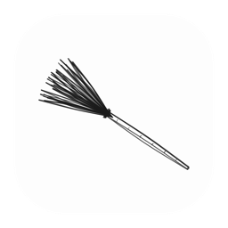

<p align="center">
  
</p>

<h1 align="center">MacOS Flusher</h1>

<p align="center">
  A small native macOS app that finds and deletes developer caches: package manager and build caches for most programming languages, Docker leftovers, IDE and tool caches, app updater leftovers.
</p>

<p align="center">
  <a href="https://bircex.github.io/macos-flusher/">Website</a> ·
  <a href="https://github.com/bircex/macos-flusher/releases/latest">Latest release</a> ·
  <a href="https://github.com/bircex/macos-flusher/issues">Report a problem</a>
</p>

The full picture, screenshots and the list of what it cleans are on the [website](https://bircex.github.io/macos-flusher/). This file covers installing and building from source.

## Install

Needs macOS 13 or newer. The app is a universal binary for Apple Silicon and Intel.

Download [MacOS-Flusher.dmg](https://github.com/bircex/macos-flusher/releases/latest/download/MacOS-Flusher.dmg) and drag the app into Applications. The app is not notarized, so macOS asks you to allow it the first time. The [install section of the website](https://bircex.github.io/macos-flusher/#install) shows how.

Or install the latest release with one command:

```
curl -fsSL https://raw.githubusercontent.com/bircex/macos-flusher/main/install.sh | bash
```

Or from a clone (needs Xcode Command Line Tools):

```
make install    # builds and copies "MacOS Flusher.app" into /Applications
make run        # builds and opens it without installing
```

## Releases

Versions follow calendar versioning, `YYYY.M.PATCH`, for example `2026.9.0`. The release workflow publishes a new version when a change to the app is merged into `main`. Each release has a DMG, a ZIP and a `SHA256SUMS` file.

## What it covers

Ten categories — Browsers, Communication, Office and documents, Media, Design and photo, Games, AI, System, Developers, and your own targets — ninety built-in targets today, most of them in Developers. The full list, with exact folders and commands, is on the website's [What it cleans](https://bircex.github.io/macos-flusher/#targets) section.

Targets whose tool is not installed are greyed out. Targets that are slow to rebuild or that delete data for good start unticked. Named Docker volumes are never removed.

## My targets

Press Add target to add a folder or a command of your own. Built-in targets cannot be edited or deleted; what you add is extra and is kept in `~/Library/Application Support/MacOS Flusher/targets.json`. Details are on the website's [My targets](https://bircex.github.io/macos-flusher/#mine) section.

## Languages

English, German, Spanish, French, Portuguese (Brazil), Russian, Turkish, Azerbaijani, Kurdish (Kurmanji and Sorani), Chinese (Simplified and Traditional), Japanese, Korean, Hindi, Bengali, Arabic, Persian and Urdu. The app follows the language of your Mac; a language can also be chosen under Settings. The translations are made by [BirceX](https://github.com/bircex/macos-flusher), the AI assistant behind the app; corrections are welcome as issues.

## How it works

Sizes come from `du` for directories and from the tool's own reporting for Docker. Deleting is either removing the directory contents or running the tool's own cleanup command (`go clean -cache`, `npm cache clean`, `docker builder prune`, `brew cleanup`). All work runs off the main thread; the UI never blocks and a scan or flush can be stopped.

Adding a built-in target is one line in `Sources/MacOSFlusher/Targets.swift`, plus its entry on the website. The `id` of a target is stored in the files of users, so it never changes. The app icon is generated by `make icon` from `Tools/make-icon.swift`.

## Contributing

See [CONTRIBUTING.md](CONTRIBUTING.md). Found a security issue? See [SECURITY.md](SECURITY.md) instead of opening a public issue.

## License

MIT
